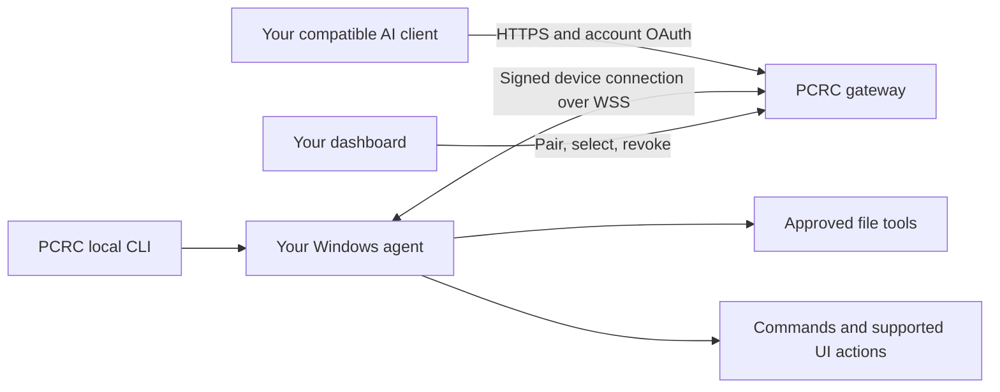

# PC Remote Commander · PCRC

**Use a compatible AI assistant with your own Windows PC.** PCRC connects the assistant to approved files, commands, a controlled browser and desktop actions, with device access managed in one dashboard.

[Website](https://pc-remote-commander.pcremotecommander.workers.dev/) · [Dashboard](https://pc-remote-commander.pcremotecommander.workers.dev/devices) · [Step-by-step setup](docs/install.md) · [npm](https://www.npmjs.com/package/pcremotecommander)

Windows beta. Bring your own compatible AI client and any plan it requires. PCRC does not include an AI model subscription and is not an approved ChatGPT or Claude directory listing.

## Why use PCRC instead of only a coding agent?

Choose PCRC when the missing piece is **access to the computer you need to work on**, rather than another AI model.

- **Use the chat client you prefer.** Connect a compatible ChatGPT, Claude or Cursor client to your paired PC. Ask it to inspect a local test failure, update an approved document or work with a supported interface without manually transferring each result into chat.
- **Choose the computer centrally.** Pair computers to your account, select which online device receives new requests, inspect usage and revoke its access from the dashboard. Keep the selected PC's agent running.
- **Combine files, terminal and visual tasks.** For example, inspect a project configuration, run an approved check, then inspect its browser output. Capabilities and confirmations still apply to every operation.
- **Build with two or three AI assistants.** Let one assistant implement a feature, another write tests, and a third review the result. Connect each compatible client and divide work with PCRC task assignments. Up to three active assignments can reserve separate file areas; participating tools reject conflicting writes and stale hashes. You manage assignments and handoffs—PCRC does not automatically launch models, merge every change or lock out unrelated programs/manual edits.
- **Recover supported file changes.** Reviewed text-edit/delete operations create recovery backups. Inspect a preview and current hash before changing important data; keep your own backups too.

### A practical comparison

| Your situation | Best starting point | Reason |
| --- | --- | --- |
| You want to build, debug and test with your preferred AI | PCRC with a compatible assistant | Connect Codex and Claude Code to the same PCRC MCP server using your account. Give each assistant a separate task: one implements a feature while the other writes tests or reviews it. Use PCRC task assignments to coordinate handoffs and block conflicting writes among participating tools. |
| You want a preferred MCP chat client to act on an account-paired PC | PCRC remote MCP | PCRC supplies the computer-access layer, selected-device routing and revocation; your AI client supplies the reasoning. |
| You know the exact local operation and want a command interface | PCRC CLI | Invoke a supported local operation or get workflow guidance without treating the CLI as an autonomous assistant. |
| You use multiple assistants on the same workspace | PCRC task assignments | Explicit reservations and handoffs reduce collisions among cooperating tools; uncertain results require review rather than automatic replay. |

There is overlap. Codex and Claude Code also support integrations and broader workflows; PCRC does not claim exclusive computer use, remote access, superior reasoning, or fewer security requirements. It can complement a coding agent. Read the current [Codex CLI guide](https://learn.chatgpt.com/docs/codex/cli) and [Claude Code overview](https://code.claude.com/docs/en/overview).

## One command for setup and reconnect

Run in PowerShell, Command Prompt or Windows Terminal:

```powershell
npx --yes pcremotecommander@beta setup
```

Prefer a double-click launcher? [Download the Windows folder](https://pc-remote-commander.pcremotecommander.workers.dev/install/PC-Remote-Commander-Windows.zip), choose **Extract All**, then open **Start-PCRC.cmd**. First use prepares missing Node.js and the bundled runtime. Keep the folder and double-click that same file for daily reconnects; keep its terminal open. This small launcher requires internet.


If `npx` is missing or that command does not work, this fallback prepares verified portable Node.js and continues setup:

```powershell
powershell -NoProfile -Command "irm https://pc-remote-commander.pcremotecommander.workers.dev/install.ps1 | iex"
```

Python is bundled. First download can take several minutes; later launches reuse the runtime. Open a new terminal after first installation before using the short command next time.

Sign in with **your own GitHub account**, compare the terminal and website codes, review computer-control permissions and approve only your own request. Leave **Use this computer for AI tools** checked. Keep the terminal running; **Ctrl+C** disconnects.

## How it fits together



The remote account reaches its own approved, selected computer. The gateway routes requests; the local service checks permissions. CLI use is local and does not itself start the remote agent. This is an access service, not a model hosting service.

## Connect ChatGPT, Claude or Cursor

Remote MCP endpoint — choose **OAuth**:

```text
https://pc-remote-commander.pcremotecommander.workers.dev/mcp
```

The dashboard's **Copy command → Connect AI → Verify → Dashboard** flow shows where to paste this URL. Follow the [client setup guide](docs/install.md), use the same PCRC account for pairing and client consent, and check connection status before a write. Control requires `pcrc:read pcrc:control` and the device's approved local capabilities. Client subscriptions and workspace restrictions apply separately.

MCP, CLI and advisory workflow skills are installed together. No separate command is needed for each tool. Skills suggest steps; they do not grant permissions. [CLI and skills reference](docs/skills.md).

## Beta terms at a glance

- Use only computers and data you own or are authorized to access. Review actions before approving.
- Full control uses your Windows account privileges. Commands may reach outside the file workspace; screenshots may contain private information.
- Tool results pass through the service and your AI provider. HTTPS/WSS is not content end-to-end encryption hiding data from them.
- Back up important data. Beta features can fail or change; there is no uptime guarantee.
- Free includes 15,000 tool calls per UTC month. See the website for current plans, localized checkout totals and applicable taxes. An enabled checkout is not proof that every payment/refund path has completed acceptance testing.

[Terms](https://pc-remote-commander.pcremotecommander.workers.dev/terms/) · [Privacy](https://pc-remote-commander.pcremotecommander.workers.dev/privacy/) · [Refund policy](https://pc-remote-commander.pcremotecommander.workers.dev/refunds/) · [Security notes](docs/security.md)

The public npm beta supports Windows. A verified public Linux/macOS installer, universal multimedia editing and public directory approval are not claimed. UTCP is a separate development-only prototype and is not enabled for public use.

This public repository contains guides and the small launcher, not hosted gateway or device-runtime source. Do not post credentials, pairing links, private configuration or user data in issues. Support: [janagiri3297@gmail.com](mailto:janagiri3297@gmail.com).
