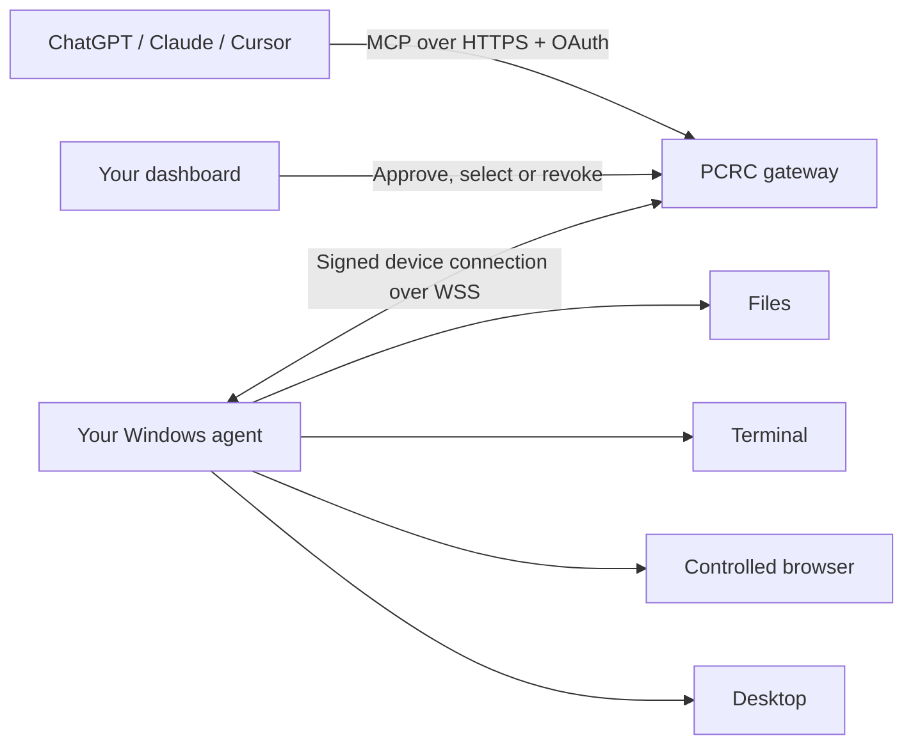

# PC Remote Commander · PCRC

Give your AI assistant tools to work on your Windows PC: manage files, run commands, use a controlled browser and interact with supported desktop interfaces.

**Public staging beta.** Windows 10/11, Node.js 20+ and npm are required. Python is bundled. This is a custom MCP connection, not an approved ChatGPT or Claude directory listing. Live billing is not enabled.

[Website](https://pc-remote-commander-staging.pcremotecommander.workers.dev/) · [Dashboard](https://pc-remote-commander-staging.pcremotecommander.workers.dev/devices) · [npm](https://www.npmjs.com/package/pcremotecommander) · [Setup guide](docs/install.md)

## One command to start

Run on the Windows PC you own or administer, in a normal PowerShell or Command Prompt:

```powershell
npx --yes pcremotecommander@beta setup
```

Sign in with **your own GitHub account** in the public website. Compare the terminal and website codes, review the computer-control permissions and approve. Leave **Use this computer for AI tools** checked. Keep the terminal running.

Full control is the standard new-device setup: files, commands, browser and desktop. It starts only after your approval and remains subject to your Windows account permissions, supported tools and action checks. Existing limited devices need fresh approval before gaining control.

## How it works



Your PC makes the outbound connection. Each account reaches its own approved, selected computer. The gateway authorizes and routes requests; the local service enforces permissions. You can stop the agent with **Ctrl+C** or revoke access on Devices.

## What you can do

| Goal | Example request |
| --- | --- |
| Understand a project | “Inspect this workspace and explain where to start.” |
| Edit files | “Preview a change to this document, then apply the approved edit.” |
| Run a task | “Run the project tests and summarize failures.” |
| Use a browser | “Open this page in the controlled browser and inspect it.” |
| Work with desktop apps | “Inspect the desktop before interacting with this app.” |
| Troubleshoot | “Suggest a workflow for diagnosing my connection.” |

Start with disposable files. For commands and other sensitive actions, review the exact operation when PCRC requests approval.

## Connect your assistant

Remote MCP endpoint — use **OAuth**:

```text
https://pc-remote-commander-staging.pcremotecommander.workers.dev/mcp
```

Follow the [ChatGPT, Claude Desktop/web and Cursor steps](docs/install.md). Use the same PCRC account for device pairing and client consent. Control needs `jan:read jan:control` plus the device's approved capabilities. Your AI client subscription and workspace policy apply separately.

## CLI and workflow skills

```powershell
npx --yes pcremotecommander@beta cli skills list
npx --yes pcremotecommander@beta cli skills route "Diagnose my computer connection"
```

In a remote MCP conversation, ask the assistant to call `suggest_workflow`. Skills suggest a plan; they do not execute it or grant extra permissions. [Workflow guide](docs/skills.md).

## Beta terms at a glance

- Use only computers and data you are authorized to access. Review actions before approving them.
- Full control runs as your Windows account; commands may reach outside the approved file workspace and screenshots may contain private information.
- Back up important files. Beta features can fail or change; no uptime guarantee is offered.
- HTTPS/WSS protect transport. This is not end-to-end encryption that hides requests from the gateway or your AI provider.
- Staging Pro checkout uses test payments. Free includes 15,000 monthly tool calls; other limits and plans are shown on the website.

Read the full [Terms](https://pc-remote-commander-staging.pcremotecommander.workers.dev/terms/), [Privacy](https://pc-remote-commander-staging.pcremotecommander.workers.dev/privacy/) and [Refund policy](https://pc-remote-commander-staging.pcremotecommander.workers.dev/refunds/). [Security notes](docs/security.md).

This public repository contains guides and the small launcher. Hosted gateway and device-runtime source are not published here. Do not put credentials, private configuration or user data in issues. Support: [janagiri3297@gmail.com](mailto:janagiri3297@gmail.com).

